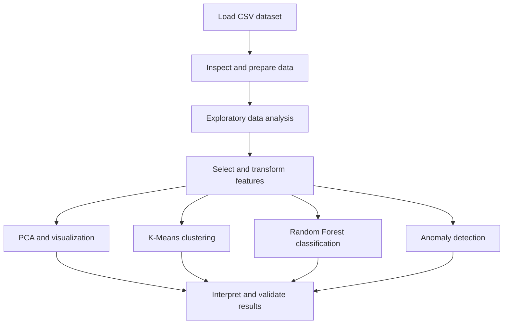

# Data Tunnels
### Data Analysis · Machine Learning · Anomaly Detection

**A Python desktop project for exploring tunnel-related data through data preparation, visualization, clustering, classification, and anomaly detection.**

</div>

---

## Table of Contents

- [Overview](#overview)
- [Project Goals](#project-goals)
- [Features](#features)
- [Machine Learning Methods](#machine-learning-methods)
- [Technology Stack](#technology-stack)
- [Project Workflow](#project-workflow)
- [Project Structure](#project-structure)
- [Requirements](#requirements)
- [Installation](#installation)
- [Running the Application](#running-the-application)
- [Building a Windows Executable](#building-a-windows-executable)
- [How to Use](#how-to-use)
- [Understanding the Methods](#understanding-the-methods)
- [Data and Responsible Use](#data-and-responsible-use)
- [Troubleshooting](#troubleshooting)
- [Future Improvements](#future-improvements)
- [Author](#author)

## Overview

**Data Tunnels** is a Python-based data analysis project focused on examining tunnel-related data and applying machine learning techniques to identify patterns, group similar observations, build predictive models, and flag potentially unusual records.

The project brings together data processing, statistical exploration, visualization, and unsupervised and supervised learning in a desktop-oriented workflow. A Tkinter interface can provide a graphical way to interact with the analysis, while Python libraries handle the underlying data and machine learning operations.

> **Important:** The exact dataset columns, interface controls, model parameters, evaluation scores, and implemented screens should be confirmed against the source code and dataset before being documented as definitive facts.

## Project Goals

- Load and inspect a structured dataset, such as a CSV file.
- Prepare data for analysis by checking column types, missing values, and numerical features.
- Explore relationships and distributions using charts and descriptive statistics.
- Reduce the number of dimensions to make complex data easier to examine.
- Group observations with similar characteristics using clustering.
- Train a classification model when suitable labels are available.
- Detect records that differ from the general pattern of the data.
- Provide an accessible desktop workflow for experimentation and analysis.
- Package the application for Windows distribution when required.

## Features

The following describes the project's intended analytical scope. Verify each item against the current implementation before treating it as a completed feature.

### 1. Data loading and preparation

- Read structured data from CSV files with Pandas.
- Inspect rows, columns, data types, and descriptive statistics.
- Identify missing or inconsistent values.
- Select numerical features for algorithms that require numerical input.
- Prepare the data for visualization and machine learning.

### 2. Exploratory data analysis

Exploratory analysis helps understand the dataset before fitting a model. Depending on the available interface and code, this can include:

- Summary statistics.
- Feature distributions.
- Correlation analysis.
- Relationships between numerical variables.
- Comparison of groups and observations.

### 3. Data visualization

Matplotlib can be used to produce plots that make patterns easier to understand, including correlation matrices, distributions, scatter plots, and cluster visualizations, where implemented.

### 4. Dimensionality reduction with PCA

Principal Component Analysis (PCA) transforms a set of potentially correlated numerical features into a smaller set of components. It can help summarize variation in the dataset and support two-dimensional visualization.

PCA is sensitive to feature scales, so standardization is often appropriate when variables use different units.

### 5. Clustering with K-Means

K-Means partitions observations into a selected number of clusters. It can help explore whether records form groups with similar feature values.

The number of clusters should be chosen based on the analysis objective and evaluated appropriately. A cluster is a mathematical grouping, not automatically a meaningful real-world category.

### 6. Classification with Random Forest

Random Forest is a supervised learning method that combines predictions from multiple decision trees. It can be used to classify records when a suitable target label exists.

Classification performance should be evaluated on data that was not used to train the model. Useful metrics may include precision, recall, F1-score, and a confusion matrix, if implemented.

### 7. Anomaly detection

The project explores anomaly detection methods such as Isolation Forest and Local Outlier Factor (LOF).

These methods can flag observations that differ from the overall data distribution. A flagged record is not necessarily an error, a dangerous event, or proof of a real-world incident; it requires further investigation.

### 8. Desktop interface

Tkinter can be used to build a desktop interface around the analysis workflow. The exact screens, buttons, and available actions depend on the current application code.

## Machine Learning Methods

| Method | Learning type | Purpose |
|---|---|---|
| PCA | Dimensionality reduction | Summarize numerical features and support visualization |
| K-Means | Unsupervised learning | Group similar observations |
| Random Forest | Supervised learning | Predict a target class when labels are available |
| Isolation Forest | Unsupervised anomaly detection | Identify observations that are relatively easy to isolate |
| Local Outlier Factor (LOF) | Local anomaly detection | Identify observations with unusual local density |

These methods answer different questions and should not be treated as interchangeable. Their suitability depends on the dataset, feature preparation, target labels, and evaluation procedure.

## Technology Stack

### Core development

- **Python** — primary programming language.
- **Tkinter** — desktop GUI toolkit, where used.
- **Pandas** — tabular data loading and manipulation.
- **NumPy** — numerical operations.
- **Matplotlib** — charts and data visualization.
- **scikit-learn** — PCA, clustering, classification, preprocessing, and anomaly detection.
- **PyInstaller** — packaging a Python application into a distributable executable, if configured.

### Main libraries

| Library / tool | Role |
|---|---|
| `pandas` | Read and manipulate tabular datasets |
| `numpy` | Numerical computing |
| `matplotlib` | Plotting and visualization |
| `scikit-learn` | Machine learning algorithms and preprocessing |
| `tkinter` | Desktop user interface |
| `PyInstaller` | Windows executable packaging |

## Project Workflow

A typical analysis workflow for this project is:

1. **Load the dataset** — read the source file and inspect its structure.
2. **Prepare the data** — handle missing values, select relevant features, and convert data into suitable formats.
3. **Explore the data** — examine statistics, distributions, and correlations.
4. **Transform features** — scale numerical variables when required and optionally apply PCA.
5. **Apply analytical methods** — run clustering, classification, or anomaly detection according to the task.
6. **Interpret the output** — inspect visualizations and model results in the context of the dataset.
7. **Validate conclusions** — evaluate models and investigate unusual observations before drawing conclusions.



## Project Structure

The exact file names may differ in the current repository. A possible organization for a Python desktop analysis project is:

```text
DataTunnels/
├── data/
│   └── tunnels_data_100_clean.csv
├── src/
│   ├── data_loader.py
│   ├── preprocessing.py
│   ├── visualization.py
│   ├── clustering.py
│   ├── classification.py
│   ├── anomaly_detection.py
│   └── app.py
├── tests/
├── requirements.txt
├── .gitignore
└── README.md
```

This is an **illustrative structure**, not a claim about the repository's actual files. Keep the README aligned with the real folder and file names.

## Requirements

- Python 3.10 or a compatible version supported by the project's dependencies.
- `pip` for installing Python packages.
- The project dataset in the expected location.
- Windows if you intend to use a Windows-specific executable produced by PyInstaller.

The compatible Python version should ultimately be confirmed from the environment in which the project runs successfully.

## Installation

### 1. Clone the repository

```bash
git clone https://github.com/lahlou4chaimaa/DataTunnels-.git
cd DataTunnels-
```

### 2. Create a virtual environment

On Windows PowerShell:

```powershell
py -m venv .venv
.\.venv\Scripts\Activate.ps1
```

If PowerShell blocks activation, you can use Command Prompt instead:

```bat
.venv\Scripts\activate.bat
```

### 3. Install dependencies

If the repository contains a `requirements.txt` file:

```powershell
python -m pip install --upgrade pip
pip install -r requirements.txt
```

If no dependency file exists, install only the libraries actually imported by the source code. For the analytical stack described above, a starting point may be:

```powershell
pip install pandas numpy matplotlib scikit-learn
```

Tkinter is usually included with standard Windows Python installations. PyInstaller is only needed if you want to build an executable:

```powershell
pip install pyinstaller
```

## Running the Application

The correct entry-point filename must be checked in the repository. If the application entry point is `main.py`, run:

```powershell
python main.py
```

If it is named `app.py`, run:

```powershell
python app.py
```

Use the filename that actually exists in the project. If the application expects a CSV file at a specific path, place the dataset there or update the path configuration in the code.

## Building a Windows Executable

If the project uses PyInstaller and the entry point is `main.py`, a basic build command is:

```powershell
pyinstaller --onedir --windowed main.py
```

For a single-file executable, if compatible with the project:

```powershell
pyinstaller --onefile --windowed main.py
```

Replace `main.py` with the real entry-point filename. Additional data files, icons, hidden imports, or model files may need explicit configuration.

Build output is normally written to `dist/`. Generated build folders should generally not be committed to GitHub. Publish source code and dependency instructions instead; distribute a compiled application separately if needed.

## How to Use

The precise steps depend on the actual interface. A general workflow is:

1. Start the desktop application.
2. Load the dataset using the available file-selection or data-loading control.
3. Inspect the dataset and check whether the data was loaded correctly.
4. Select the features relevant to the analysis.
5. Run the available visualization or machine learning operation.
6. Review the plots, clusters, predictions, or anomaly indicators.
7. Save or export results only if the application provides that functionality.

Do not assume that every operation listed here is accessible through the GUI until it has been checked in the code.

## Understanding the Methods

### PCA

PCA finds directions that capture variation in numerical data. It is useful for summarizing information and visualizing high-dimensional observations, but the components may be less directly interpretable than the original features.

### K-Means

K-Means assigns each observation to one of *K* clusters. It requires a chosen number of clusters and can be affected by feature scaling, outliers, and the initial placement of cluster centers.

### Random Forest

Random Forest learns from labeled examples. A reliable evaluation requires a suitable train/test split or cross-validation. If classes are imbalanced, accuracy alone may be misleading.

### Isolation Forest

Isolation Forest identifies observations that are easier to isolate from the rest of the dataset. Its output is an anomaly indicator, not a definitive judgment about an observation.

### Local Outlier Factor

LOF compares the local density around an observation with the density around its neighbors. Its output depends on parameters and the structure of the dataset.

## Data and Responsible Use

- Check that the dataset may legally and ethically be shared.
- Remove confidential information, credentials, and personal data before publishing.
- Do not commit virtual environments, caches, compiled build output, or large temporary files.
- Do not report model accuracy, anomaly counts, or performance claims unless they have been measured and verified.
- Treat machine learning results as analytical signals that require context and validation.
- If the dataset is too large for ordinary Git storage, consider keeping it outside the repository and documenting how to obtain it.

## Troubleshooting

### `ModuleNotFoundError`

Activate the project's virtual environment and install the missing dependency. Confirm that the Python interpreter used to run the application is the same one used to install packages.

### Dataset file not found

Check the dataset filename, its directory, and how the source code constructs file paths. Relative paths may behave differently depending on the current working directory.

### Tkinter window does not open

Confirm that the installed Python distribution includes Tkinter. Run the application from a terminal to inspect error messages.

### PyInstaller executable fails

Test the Python application before packaging it. Check the build output, required data files, hidden imports, and dependency compatibility. Build the executable on the target operating system.

### GitHub push fails because the repository is too large

Exclude generated folders such as `dist/`, `build/`, `.venv/`, and cache directories with `.gitignore`. If large files were already committed, removing them from the current working directory is not enough to remove them from Git history; the history may need to be cleaned before pushing.

## Future Improvements

Potential improvements, depending on the current implementation, include:

- Add automated tests for data preparation and model workflows.
- Provide configurable feature selection and model parameters.
- Add reproducible train/test evaluation and clear metric reporting.
- Export analysis summaries and visualizations.
- Improve error handling for invalid or incomplete datasets.
- Record model settings and dataset versions for reproducibility.
- Separate the interface, data-processing logic, and machine learning modules.
- Add continuous integration to run tests on each change.
- Document the actual dataset schema and include a small, non-sensitive sample.

## Author

**Chaimaa Lahlou**  
Computer Engineering Student — IT Engineering and Networks  
Casablanca, Morocco

- GitHub: [@lahlou4chaimaa](https://github.com/lahlou4chaimaa)
- Project repository: [DataTunnels-](https://github.com/lahlou4chaimaa/DataTunnels-)

---

<div align="center">

*Data analysis · Machine learning · Continuous improvement*

</div>
